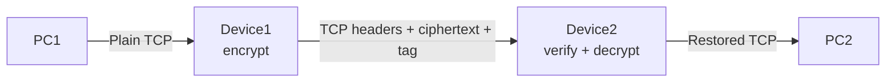

# Secure Inline TCP Channel — Linux/C Prototype

This project implements the required inline topology:

```text
PC1 → Device1 → Device2 → PC2
```

Device1 and Device2 establish a secure session with ephemeral finite-field
Diffie–Hellman (`ffdhe2048`) before their NFQUEUE packet loops start. For every
selected TCP/IPv4 data packet, the sending device encrypts only the TCP payload
with AES-256-GCM. The inter-device packet is exactly:

```text
original IPv4 header | original TCP header | ciphertext | 16-byte GCM tag
```

There is no UDP tunnel, outer IP packet, or custom data-plane header. The
receiving device authenticates the packet, removes the tag, decrypts the
payload, restores the original IP length, recalculates IPv4/TCP checksums, and
lets Linux forward the packet to the destination host.

## Requirement summary

| Requirement | Implementation |
|---|---|
| Linux inline devices | nftables `forward` hook + `libnetfilter_queue` |
| Selected TCP/IPv4 traffic | Configurable TCP service port in `setup_device.sh` |
| Session before data | Handshake completes before NFQUEUE handles are opened; nft rules are fail-closed |
| Diffie–Hellman | Ephemeral RFC 7919 `ffdhe2048` through OpenSSL 3 EVP |
| Session keys | HKDF-SHA256 over DH secret, both randoms, transcript, and optional PSK |
| Payload-only encryption | AES-256-GCM operates only on bytes after the TCP header |
| Headers preserved | Headers remain in place and are also authenticated as GCM AAD |
| Tag appended | 16-byte tag follows the ciphertext |
| No UDP/custom header | Data plane retains native TCP/IPv4 packet structure |
| Unique nonce | Per-direction random 32-bit session prefix + monotonic 64-bit packet counter |
| Receiver verification | GCM tag must verify before plaintext is forwarded |
| Checksums | IPv4 and TCP checksums recomputed after both transformations |
| Replay defense | Sliding replay window; an accepted counter cannot be accepted again |
| Tests and packaging | Unit, sanitizer, namespace integration tests, and ZIP script |

The detailed one-to-one mapping is in
[docs/REQUIREMENTS_TRACEABILITY.md](docs/REQUIREMENTS_TRACEABILITY.md).

## Design



The reverse direction uses separate keys and nonce spaces:

- Device1 → Device2: `c2s_key`, `c2s_nonce_prefix`, counter starting at 0.
- Device2 → Device1: `s2c_key`, `s2c_nonce_prefix`, counter starting at 0.

The 96-bit GCM nonce is not sent in the packet:

```text
nonce = 4-byte per-session/per-direction prefix || 8-byte packet counter
```

The receiver tries only unconsumed counters inside a bounded look-ahead/replay
window and accepts a counter only when the GCM tag verifies. This makes the
nonce implicit, keeps the required wire format free of custom metadata, handles
limited loss/reordering, and rejects replays. See
[docs/SECURITY.md](docs/SECURITY.md) for the proof and trade-offs.

## Dependencies

Target: Ubuntu 22.04/24.04 or another recent Linux distribution with:

- C17 compiler and GNU Make
- OpenSSL 3 development package
- `libnetfilter_queue` development package
- nftables, iproute2, and ethtool
- root privileges or equivalent `CAP_NET_ADMIN` for NFQUEUE/network setup

Install on Debian/Ubuntu:

```bash
sudo ./scripts/install_deps.sh
```

## Build and test

```bash
make
make test
make sanitize
make smoke
sudo ./tests/test_integration.sh
```

`make test` and `make smoke` do not require root. The smoke test starts two real
daemon processes and verifies their matching handshake session IDs. The
integration test creates four temporary
network namespaces, reproduces the complete topology, runs an HTTP exchange,
checks both daemons' encrypted/decrypted packet logs, and—when tcpdump is
available—verifies that a unique plaintext marker is absent from the
inter-device link. All namespaces and processes are removed on exit.

On a minimal CI container without the NFQUEUE development package, the crypto,
packet, handshake, and unit tests still build. `make syntax-daemon` type-checks
the daemon against a compile-only API stub; a real `make` always requires and
links the genuine system `libnetfilter_queue`.

## Quick automated demonstration

After `make`:

```bash
sudo ./tests/test_integration.sh
```

Expected final output:

```text
[PASS] namespace integration: HTTP succeeded through encrypted inline path
[PASS] both directions encrypted/decrypted protected TCP payloads
[PASS] plaintext marker absent from inter-device packet capture
```

## Physical/VM lab setup

The example addressing is:

| Node/interface | Address | Purpose |
|---|---:|---|
| PC1 | `10.0.1.2/24` | Source host |
| Device1 host side | `10.0.1.1/24` | Faces PC1 |
| Device1 peer side | `10.0.12.1/30` | Faces Device2 |
| Device2 peer side | `10.0.12.2/30` | Faces Device1 |
| Device2 host side | `10.0.2.1/24` | Faces PC2 |
| PC2 | `10.0.2.2/24` | Destination host |

1. Put the correct addresses and routes on all four Linux hosts/VMs.

2. Generate one fresh PSK and copy the same value into both configuration
   files:

   ```bash
   ./scripts/generate_psk.sh
   cp configs/device1.conf /tmp/device1.conf
   cp configs/device2.conf /tmp/device2.conf
   # Replace psk_hex in both /tmp files with the generated value.
   ```

3. On Device1, where `host0` faces PC1 and `peer0` faces Device2:

   ```bash
   sudo ./scripts/setup_device.sh device1 host0 peer0 8080 100 101
   ```

4. On Device2, where `host0` faces PC2 and `peer0` faces Device1:

   ```bash
   sudo ./scripts/setup_device.sh device2 host0 peer0 8080 100 101
   ```

5. Start Device2 first, then Device1:

   ```bash
   # Device2
   sudo ./bin/sicd --config /tmp/device2.conf

   # Device1, in a second terminal/machine
   sudo ./bin/sicd --config /tmp/device1.conf
   ```

6. Start a TCP service on PC2 and access it from PC1:

   ```bash
   # PC2
   python3 -m http.server 8080 --bind 10.0.2.2

   # PC1
   curl http://10.0.2.2:8080/
   ```

7. Remove only this project's nftables table when finished:

   ```bash
   sudo ./scripts/cleanup_device.sh peer0
   ```

The setup increases the inter-device MTU to 1520 because an encrypted packet is
16 bytes longer. Both peer-link interfaces must support that MTU. If they do
not, reduce the endpoint/path MTU to 1484 instead.

## Configuration keys

| Key | Meaning | Default/range |
|---|---|---|
| `role` | `device1` (client) or `device2` (server) | Required |
| `peer_address` | Device2 control address | Required on Device1 |
| `listen_address` | Device2 bind address | `0.0.0.0` |
| `control_port` | TCP handshake port | `47000` |
| `encrypt_queue` | NFQUEUE number for outbound plaintext | `100` |
| `decrypt_queue` | NFQUEUE number for inbound protected packets | `101` |
| `replay_window` | Remembered counters for reordering/replay | `8..4096`, default `128` |
| `counter_lookahead` | Missing counters tried before rejection | `1..4096`, default `128` |
| `connect_timeout_seconds` | Device1 connection retry period | Default `30` |
| `psk_hex` | Optional handshake-authentication PSK | 0 or at least 16 bytes; 32 recommended |
| `log_level` | `error`, `warn`, `info`, `debug` | `info` |

Unknown keys and invalid values cause startup failure.

## Important behavior

- TCP SYN/FIN/RST and pure ACK packets have no TCP payload, so they pass
  unchanged. Data packets are protected.
- Selected fragmented IPv4 traffic is dropped by nftables. This prevents
  non-initial fragments from bypassing the TCP-port selector.
- GCM authentication covers source/destination addresses, IP/TCP fields,
  options, and the normalized original length. TTL and checksum fields are
  normalized because forwarding legitimately changes/recomputes them.
- Authentication failure, malformed packets, replay, counter-window failure,
  and counter exhaustion are fail-closed (`NF_DROP`).
- TCP sequence/acknowledgment numbers and ports are never changed. The extra
  tag exists only on the private inter-device hop and is removed before PC2.
- A PSK is strongly recommended. Plain ephemeral DH provides secrecy but does
  not by itself authenticate the peer against a man-in-the-middle.

## Project layout

```text
include/sic/       Public C headers
src/               Daemon, crypto, handshake, packet, NFQUEUE code
configs/           Device1/Device2 example configurations
scripts/           Dependency, nftables, cleanup, PSK, ZIP scripts
tests/             Unit, sanitizer, and namespace integration tests
docs/              Architecture, protocol, security, test, and defense notes
packaging/          Optional systemd unit
```

## Submission ZIP

```bash
make package
```

This creates `../Secure_Inline_Channel_C_Submission.zip` without build outputs
or runtime logs.

## Documentation

- [Architecture](docs/ARCHITECTURE.md)
- [Handshake and data-plane protocol](docs/PROTOCOL.md)
- [Security analysis](docs/SECURITY.md)
- [Test plan](docs/TEST_PLAN.md)
- [Requirements traceability](docs/REQUIREMENTS_TRACEABILITY.md)
- [Short submission report](docs/SUBMISSION_REPORT.md)
- [Oral defense guide](docs/DEFENSE_GUIDE.md)

## Primary API references

- OpenSSL 3 EVP/DH and `ffdhe2048` documentation:
  <https://docs.openssl.org/3.5/man3/EVP_PKEY_CTX_ctrl/>
- OpenSSL authenticated-encryption interface:
  <https://docs.openssl.org/3.4/man3/EVP_EncryptInit/>
- Official libnetfilter_queue documentation:
  <https://netfilter.org/projects/libnetfilter_queue/doxygen/html/>
- Official nftables queue statement:
  <https://netfilter.org/projects/nftables/manpage.html>

## Scope

This is an academic Linux prototype, not a replacement for standardized VPN or
IPsec software. Its constraints and production-hardening gaps are documented
explicitly in [docs/SECURITY.md](docs/SECURITY.md).
