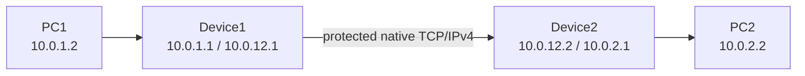

# Architecture

## 1. Components

| Component | Responsibility |
|---|---|
| nftables rules | Select the configured TCP/IPv4 flow, reject fragments, and enqueue packets fail-closed |
| `sicd` handshake | Establish and confirm an FFDHE2048 shared secret before packet processing |
| Key schedule | Derive independent directional AES keys, nonce prefixes, and a finished key with HKDF-SHA256 |
| Encrypt queue | Parse packet, construct AAD, encrypt TCP payload, append tag, update length/checksums |
| Decrypt queue | Find implicit counter, verify tag, reject replay, decrypt, remove tag, update length/checksums |
| Linux router | Route the modified native IPv4/TCP packet directly between the hosts/devices |

## 2. Topology and routing

The devices are routers, not TCP proxies. PC1 and PC2 keep one normal end-to-end
TCP connection. The devices never terminate it, change its ports, or consume
sequence space.

## 3. Startup order

1. Configure routes, peer-link MTU, forwarding, and nftables.
2. Start Device2; it waits on the control TCP port.
3. Start Device1; it connects to Device2.
4. Both generate ephemeral FFDHE2048 key pairs and exchange public values and
   randoms.
5. Both derive and confirm the same key schedule.
6. Only after successful confirmation does each process open its encrypt and
   decrypt NFQUEUE handles.
7. Selected packets are processed. Until step 6, fail-closed queue rules do not
   forward selected data payloads unprotected.

## 4. Forward packet path

For a PC1 → PC2 packet containing application data:

1. Device1's nftables rule queues the packet to the encrypt queue.
2. `sic_packet_parse` validates IPv4/TCP sizes and rejects fragments.
3. Headers are copied unchanged into a new buffer.
4. A canonical header copy becomes GCM AAD. The IP/TCP checksum fields and TTL
   are zeroed in the AAD; the IP length is normalized to the plaintext length.
5. The TCP payload is encrypted with the next unique directional nonce.
6. The 16-byte GCM tag is appended.
7. IPv4 total length and both checksums are updated for the protected packet.
8. `nfq_set_verdict(..., NF_ACCEPT, modified_packet)` reinjects the packet.
9. Linux routes it directly to Device2 using its original destination IP.
10. Device2 queues the packet to its decrypt queue.
11. It tries bounded unused receive counters; only the correct nonce validates
    the GCM tag.
12. It records that counter to prevent replay, decrypts the payload, strips the
    tag, restores length/checksums, and accepts the packet toward PC2.

The response path is identical with the independent Device2 → Device1 key and
nonce counter.

## 5. Why TCP remains correct

The extra tag exists only between the two devices. TCP sequence and ACK numbers
are not adjusted because neither endpoint sees the tag:

| Location | TCP payload seen |
|---|---|
| PC1 → Device1 | `N` plaintext bytes |
| Device1 → Device2 | `N` ciphertext bytes + 16 tag bytes |
| Device2 → PC2 | Original `N` plaintext bytes |

Both endpoint-visible packets therefore carry exactly the same TCP sequence
space. Pure ACK/SYN/FIN/RST packets contain no payload and pass unchanged.

## 6. MTU

AES-GCM ciphertext has the same length as plaintext, but the tag adds 16 bytes.
The default lab design uses a 1520-byte inter-device MTU so an original
1500-byte IPv4 packet becomes at most 1516 bytes. If a peer link cannot carry
that size, endpoint/path MTU must be at most 1484.

## 7. Process model

One `sicd` process owns both queues through one libnetfilter_queue handle and
one event loop. This provides deterministic counter allocation and avoids two
threads competing for the same protocol-family binding. Signal handling sets a
`sig_atomic_t` flag; the poll loop checks it every 500 ms and performs orderly
key erasure and queue cleanup.
