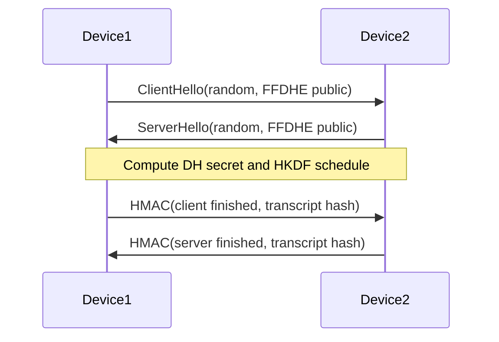

# Handshake and Data-Plane Protocol

## 1. Control-plane handshake

The handshake uses a direct TCP control connection between Device1 and Device2.
This connection is not an encapsulation for protected data. It ends after key
confirmation.

### 1.1 Hello message

All integer fields use network byte order.

| Offset | Size | Field |
|---:|---:|---|
| 0 | 4 | Magic `SIC1` |
| 4 | 1 | Protocol version (`1`) |
| 5 | 1 | Role (`1` Device1, `2` Device2) |
| 6 | 2 | Reserved, must be zero |
| 8 | 32 | Cryptographic random |
| 40 | 4 | DER public-key length |
| 44 | variable | DER SubjectPublicKeyInfo for FFDHE2048 public key |

Messages larger than 4096 public-key bytes, wrong versions/roles, nonzero
reserved bytes, invalid DER, non-DH keys, non-`ffdhe2048` groups, and invalid DH
public values are rejected.

### 1.2 Exchange



Device2 sends its finished value only after verifying Device1's. Device1 does
not start its packet loop until it verifies Device2's.

### 1.3 Transcript and key schedule

Definitions:

```text
transcript      = exact ClientHello || exact ServerHello
transcript_hash = SHA-256(transcript)
salt            = SHA-256(client_random || server_random || PSK)
IKM             = FFDHE2048 shared secret
info            = "SIC-v1 key schedule" || transcript_hash
material        = HKDF-SHA256(IKM, salt, info, 104 bytes)
```

The 104 bytes are split in this order:

| Bytes | Purpose |
|---:|---|
| 0–31 | Device1 → Device2 AES-256 key |
| 32–63 | Device2 → Device1 AES-256 key |
| 64–67 | Device1 → Device2 nonce prefix |
| 68–71 | Device2 → Device1 nonce prefix |
| 72–103 | Handshake finished HMAC key |

`session_id` is the first 16 bytes of `transcript_hash` and is included in
every packet's AAD. Keys and prefixes are never logged.

The PSK is optional for assignment compatibility. When present, it authenticates
the key schedule against a network man-in-the-middle. When absent, the daemon
prints an explicit warning.

## 2. Data plane

### 2.1 Plain packet

```text
IPv4 header | TCP header | plaintext payload
```

### 2.2 Protected inter-device packet

```text
IPv4 header | TCP header | AES-GCM ciphertext | 16-byte tag
```

No nonce, sequence metadata, UDP header, outer IP header, or custom protocol
header is added.

### 2.3 Nonce

```text
nonce[0..3]  = directional prefix derived by HKDF
nonce[4..11] = unsigned 64-bit packet counter, big endian
```

Counters begin at zero for each direction in each new session. Atomic
compare-and-exchange reserves a counter once. Retransmitted TCP packets receive
new counters and therefore new nonces/ciphertexts. The daemon refuses to wrap a
counter and requires a new session instead.

### 2.4 AAD

The AAD is:

```text
"SIC1" || session_id || canonical IPv4 header || canonical TCP header
```

Canonicalization:

- IPv4 total length is the original plaintext packet length.
- IPv4 TTL is zero because every router legitimately decrements it.
- IPv4 and TCP checksum fields are zero because they are recalculated.
- All remaining header fields and options retain their packet values.

Thus a change to addresses, ports, TCP sequence/ACK numbers, flags, window,
options, IP identification, protocol, or normalized length causes tag failure.

### 2.5 Receive counter discovery

Because the assignment forbids a custom data-plane header, the counter is not
transmitted. The receiver:

1. Tries unused counters from `highest + 1` through the configured look-ahead.
2. If needed, tries unseen counters in the retained replay window below the
   highest value.
3. Accepts the first counter whose GCM tag verifies.
4. Marks it consumed; the same counter can never be accepted twice.

The search is bounded to limit CPU use. A packet outside both bounds is dropped.

## 3. Error policy

The protected flow is fail-closed. These conditions yield `NF_DROP`:

- malformed/truncated IPv4 or TCP header;
- selected IPv4 fragment;
- protected payload too short for ciphertext and tag;
- invalid GCM tag or modified authenticated header;
- replayed/too-old/too-far-ahead counter;
- packet too large after adding the tag;
- nonce counter exhaustion;
- allocation or cryptographic API failure.

Packets with a valid TCP/IPv4 structure but no TCP payload pass unchanged.
